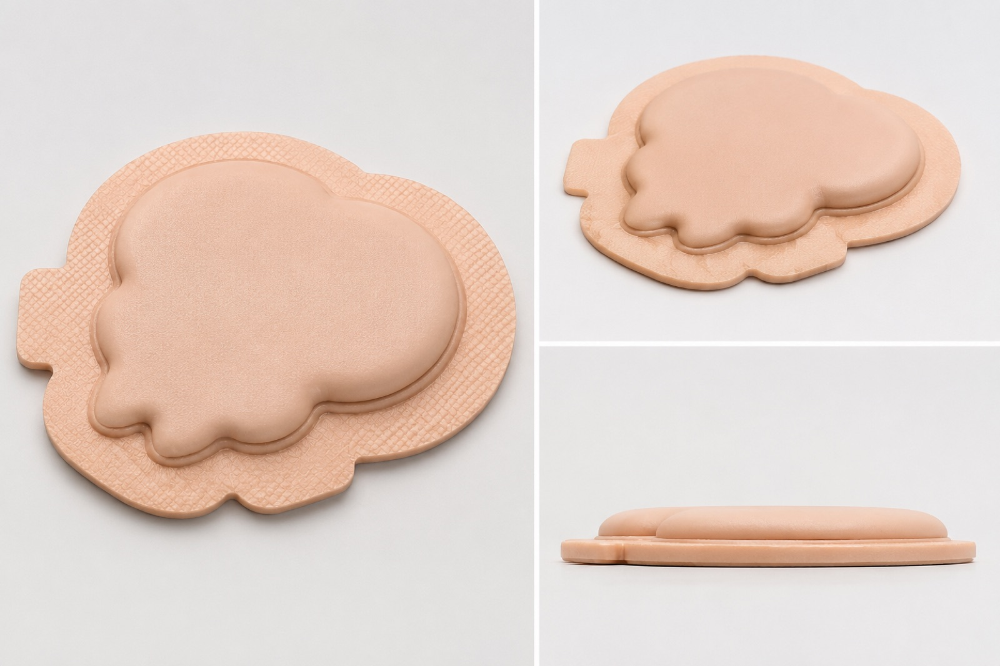

# UlcerSafe

**Un parche inteligente para ayudar a prevenir las úlceras por presión.**

🏆 Premio Principal · VI Premios Sergio Pomar Montahud 2026 (ASELEC)

---

Las úlceras por presión afectan a muchas personas mayores y dependientes que pasan largas horas en la cama, y en la mayoría de los casos se pueden evitar. UlcerSafe ayuda a quienes cuidan a actuar en el momento adecuado.

## Qué hace

- **Vigila de forma continua y discreta** la zona de riesgo, sin molestar a la persona.
- **Avisa a quien cuida** cuando conviene actuar.
- **Reutilizable**, pensado para residencias, hospitales y el propio domicilio.
- **La decisión siempre es de una persona**: UlcerSafe ayuda, no sustituye al profesional ni al cuidador.

## Estado

Proyecto en desarrollo. Los detalles técnicos no son públicos por ahora.

---

Creado por <a href="https://github.com/raulhernandezherce">Raúl Hernández Herce</a> · © 2026 · Todos los derechos reservados
